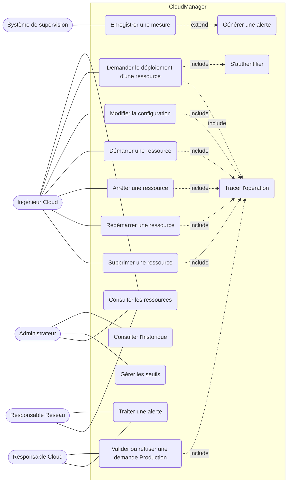

# Phase 2 – Élaboration : diagramme de cas d'utilisation

## Acteurs et cas d'utilisation

> Notation : `include` = inclusion obligatoire ; `extend` = extension conditionnelle (la génération d'alerte n'a lieu que si la mesure dépasse le seuil). Mermaid n'a pas de diagramme de cas d'utilisation natif : pour un rendu UML strict, refaites-le avec PlantUML ou draw.io et exportez-le dans `diagrams/img/`.

## Description des cas principaux

| Cas | Acteur | Pré-condition | Résultat |
|---|---|---|---|
| Demander le déploiement | Ingénieur Cloud | Authentifié, droit sur l'environnement | Demande créée (numéro, date, demandeur, état) |
| Valider / refuser | Responsable Cloud | Demande Production « En attente de validation » | Demande « Validée » ou « Refusée » |
| Démarrer / arrêter / redémarrer | Ingénieur Cloud | Ressource dans un état compatible | État de la ressource mis à jour et tracé |
| Traiter une alerte | Resp. Cloud / Resp. Réseau | Alerte « Nouvelle » | Alerte « Prise en charge » puis « Résolue » |
