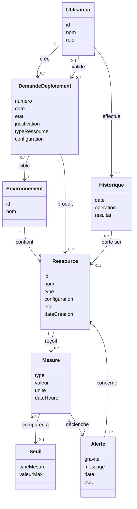

# Phase 2 – Élaboration : diagramme de classes d'analyse

## Remarques d'analyse

- Une ressource appartient à **un seul** environnement.
- Les types de ressources (machine virtuelle, conteneur, réseau virtuel, stockage) sont raffinés en Construction.
- Une demande ne produit une ressource qu'en cas de succès du déploiement (cardinalité `0..1`).
