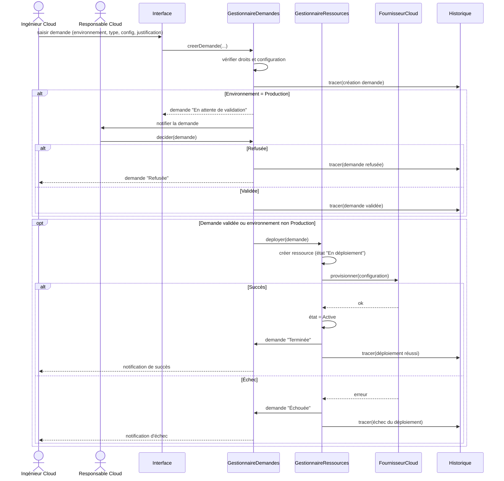

# Phase 2 – Élaboration : séquence détaillée « Déployer une ressource Cloud »

## Scénario nominal (environnement Production)

1. L'Ingénieur Cloud crée la demande (environnement, type, configuration, justification).
2. Le système enregistre la demande (état *En attente de validation*).
3. Le Responsable Cloud valide.
4. Le système lance le déploiement (demande *En cours*, ressource *En déploiement*).
5. Le déploiement réussit : ressource *Active*, demande *Terminée*.

## Scénarios alternatifs

- **Refus** : demande *Refusée*, aucune ressource créée.
- **Échec** : demande *Échouée*, événement enregistré dans l'historique.
- **Dev / Test** : pas de validation, passage direct au déploiement.

## Diagramme

