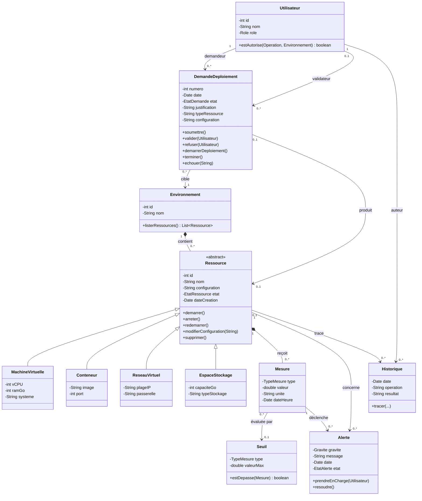
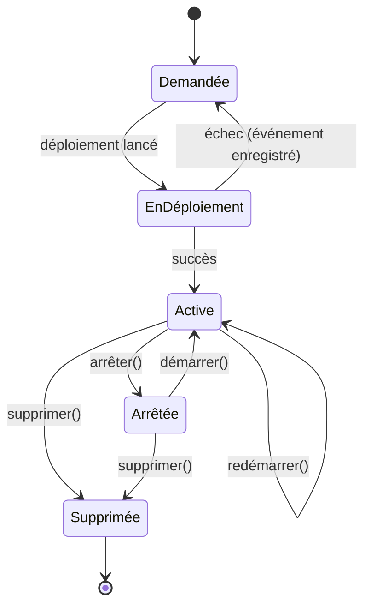
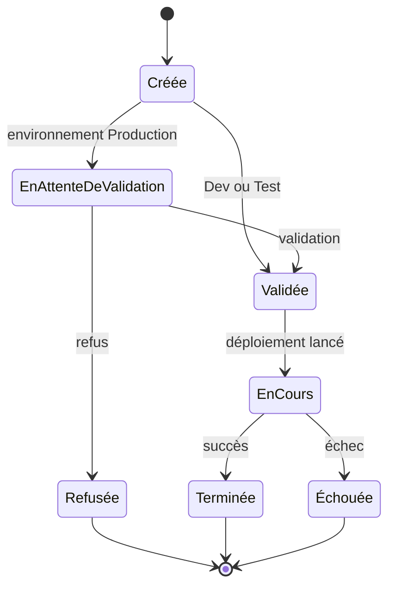
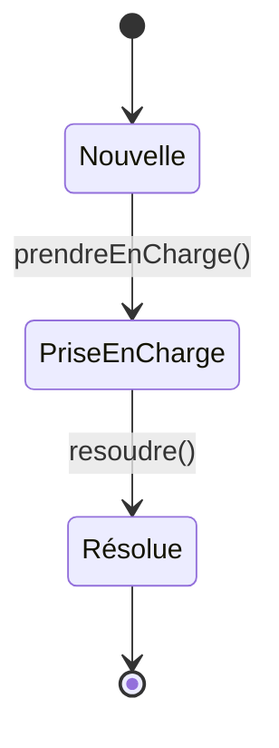

# Phase 3 – Construction : classes raffinées, états et cohérence

## 1. Diagramme de classes raffiné

## 2. Contraintes (OCL / texte)

| Id | Contrainte |
|---|---|
| C1 | `Ressource` appartient à exactement un `Environnement` |
| C2 | Si `DemandeDeploiement.environnement = Production`, elle ne peut passer à *Validée* que par un `Utilisateur` de rôle Responsable Cloud |
| C3 | Une `Alerte` est créée seulement si `mesure.valeur > seuil.valeurMax` pour le même `TypeMesure` |
| C4 | Une opération non autorisée (état incompatible ou droits insuffisants) ne modifie pas `Ressource.etat` |
| C5 | Toute opération importante crée une ligne `Historique` |
| C6 | `Ressource.dateCreation` est non modifiable |

## 3. Diagrammes d'états

### Ressource

### Demande de déploiement

### Alerte

## 4. Vérification de cohérence entre diagrammes

| Vérification | Diagrammes concernés | Statut |
|---|---|---|
| Chaque cas d'utilisation a au moins une interaction | Cas d'utilisation ↔ Séquence | ✔ pour « Déployer » ; à compléter pour les autres cas |
| Les messages de la séquence correspondent à des opérations de classes | Séquence ↔ Classes | ✔ (`creerDemande`, `valider`, `deployer`, `tracer`) |
| Les états de la demande/ressource sont ceux de l'énoncé | États ↔ Énoncé | ✔ |
| Les nœuds de l'activité reprennent les états | Activité ↔ États | ✔ |
| Les classes de l'analyse sont conservées | Analyse ↔ Construction | ✔ (+ spécialisations de `Ressource`) |

> Le cycle de vie « Demandée → En déploiement → Active → Arrêtée → Active → Supprimée » de l'énoncé est respecté. Le retour *En déploiement → Demandée* en cas d'échec est une hypothèse : à justifier ou à remplacer par un état *Échec* selon votre choix.
