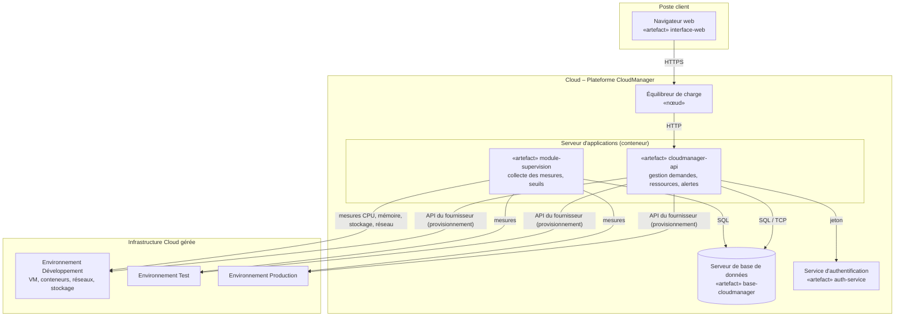

# Phase 4 – Transition : diagramme de déploiement

## Proposition d'architecture

CloudManager est déployé dans le Cloud : une application web, une API, une base de données et un module de
supervision qui interroge les ressources des environnements Développement, Test et Production.

## Nœuds, artefacts et relations

| Nœud | Artefacts | Relation |
|---|---|---|
| Poste client | interface-web | HTTPS vers l'équilibreur |
| Équilibreur de charge | configuration du proxy | HTTP vers le serveur d'applications |
| Serveur d'applications | cloudmanager-api, module-supervision | SQL vers la base, API Cloud vers les environnements |
| Serveur de base de données | base-cloudmanager | accessible uniquement depuis le serveur d'applications |
| Service d'authentification | auth-service | jeton vérifié par l'API |
| Environnements Dev / Test / Prod | ressources gérées | provisionnement et mesures |

## Recommandations de déploiement

- Réseau privé pour la base de données ; seul l'équilibreur est exposé.
- Sauvegardes régulières de la base, surtout de l'historique.
- Déploiement progressif : Développement → Test → Production.
